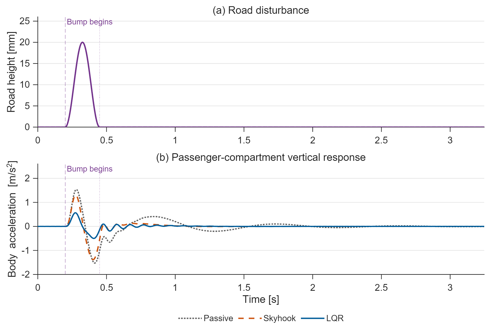
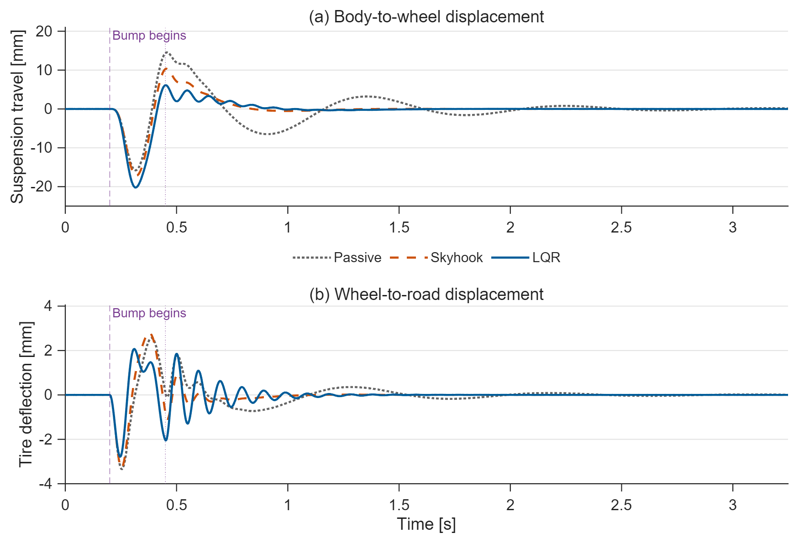
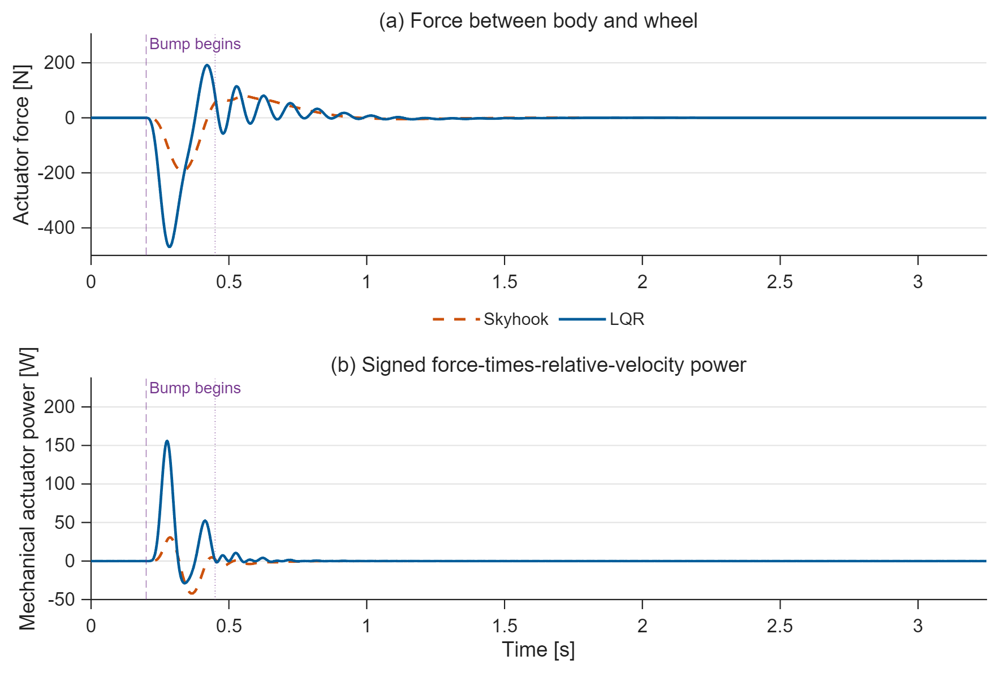

# Quarter-Car Active Suspension

Compare passive suspension, active skyhook damping, and saturated LQR on the
same two-mass quarter-car model and road bump.

## Run

Requires **MATLAB, Simulink and Control System Toolbox**; verified on **R2025b**.
Open this folder in MATLAB and run `run_demo` or `run_demo(false)`.
`project_parameters.m` holds the physical values; `quarter_car_model.m` derives
the plant and control gains. The editable model is `quarter_car.slx`.

## Results

**Figure 1. Ride response to a road bump.** The 20 mm raised-cosine bump begins
at 0.20 s and ends at 0.45 s. LQR reduces body-acceleration RMS from 0.3469 to
0.1029 m/s² in this test, a 70.34% reduction. All cases are shown until after
the slowest post-bump response settles, at 3.248 s.

**Figure 2. Mechanical trade-off.** LQR increases peak suspension travel from
15.79 to 20.22 mm while reducing peak tire deflection from 3.34 to 2.78 mm.
The comfort improvement therefore uses more suspension travel; it is not a
uniform improvement in every metric.

**Figure 3. Actuator effort.** Peak force is 193.82 N for skyhook and 469.20 N
for LQR, below the common 1200 N limit. Signed mechanical power is force times
body-to-wheel velocity; this is not electrical supply power or actuator efficiency.
Bump onset and completion are marked on every time-domain panel.

PNG previews, vector PDFs, CSV signals, controller gains and metrics are in
`results/`. The horizon follows a 2%-of-peak settling rule for acceleration,
suspension travel and tire deflection, with 20% headroom. RMS values use the
same interval, from bump onset to the common endpoint.

## Model and checks

States are body position/velocity and wheel position/velocity, measured about
static equilibrium. Positive actuator force acts upward on the body and equally
downward on the wheel. `run_demo` checks an independent ODE implementation,
closed-loop stability, actuator bounds, and positive tire normal force.

This release tests one deterministic bump with ideal state feedback. It does
not implement an ISO road profile, weighted human-comfort assessment, actuator
bandwidth, or sensor noise. Skyhook and LQR use the same passive spring/damper.

Topic: **P04** in Muhammad Mudassir Shakeel's
[*MATLAB, Simulink & Simscape Project-Based Masterbook*](https://buymeacoffee.com/engrprogrammer).
The implementation and results are original. [MIT License](LICENSE).
